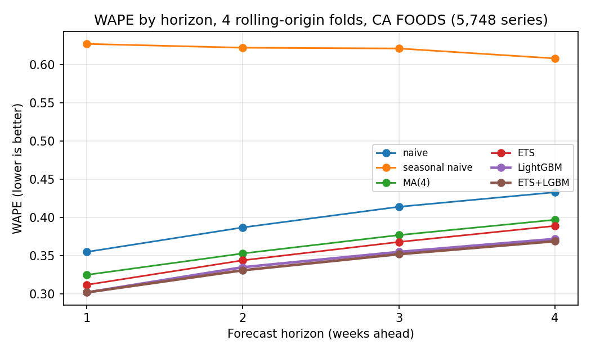

# Weekly Demand Forecasting on M5 (Walmart): Baselines vs. Statistical vs. ML

Forecasting weekly unit sales 1–4 weeks ahead for **5,748 item-store series** (California stores, FOODS category) from the M5 dataset. Six approaches are compared on identical rows under a leakage-safe rolling-origin backtest. The data pipeline is built in SQL (DuckDB).

## Headline results

| Model | Overall WAPE | vs. naive |
|---|---|---|
| Seasonal naive (same week last year) | 0.620 | worse |
| Naive (last week) | 0.397 | – |
| Moving average, 12 weeks | 0.399 | 0% |
| Moving average, 4 weeks | 0.363 | −9% |
| ETS (AutoETS, non-seasonal) | 0.353 | −11% |
| LightGBM (Tweedie, direct per-horizon) | 0.341 | −14% |
| ETS + LightGBM average | 0.339 | −15% |
| **LightGBM quantile (median)** | **0.336** | **−15%** |



**Key findings**

- **Beating naive is easy. Beating a good simple model is not.** Most of LightGBM's gain over naive comes from smoothing, which a 4-week moving average captures (−9%). Against ETS, the strongest non-ML model, LightGBM's edge is about **3%**.
- **The ML advantage grows with horizon**: 0.010 WAPE over ETS at h=1, 0.017 at h=4. When recent sales are stale, price and calendar features carry more weight.
- **About 80% of LightGBM's gain over ETS comes from normal weeks, not promotions.** LightGBM is far better in discount weeks (WAPE 0.685 vs. 0.826), but those weeks are only 1.4% of sales.
- **Yearly seasonality is weak at item level.** Seasonal naive is the worst model on every fold and horizon, and a 12-week average is worse than a 4-week one. Demand levels drift, so recency matters most. This is why ETS was fitted without a seasonal component.
- **Every model under-forecasts** (total forecast / total actual between 0.93 and 0.97). Test-period demand ran above recent history. For inventory decisions this leans toward stock-outs, which motivates the cost analysis below.
- **The ensemble is chosen for stability, not accuracy.** It beats LightGBM by only 0.002 overall, but improves the worst fold (0.349 vs. 0.357) and is never meaningfully worse, except in discount weeks, where ETS drags it down.

## Data

- **Source:** [M5 Forecasting – Accuracy](https://www.kaggle.com/competitions/m5-forecasting-accuracy/data): daily Walmart unit sales, 2011–2016, with calendar, SNAP, event, and price tables.
- **Subset:** state `CA` (4 stores) × category `FOODS` (3 departments) gives 5,748 series and 11.2M daily rows.
- **Weekly aggregation:** 1.22M series-week rows after cleaning.
- **Cleaning:**
  - Pre-launch weeks (no listed price) are dropped, because their zeros are not real demand.
  - Partial weeks at the calendar edges are dropped.
  - All series were verified to be contiguous with no mid-series gaps, so row-based window functions are valid.

## Pipeline

All data preparation is in SQL (`sql/`), executed through DuckDB:

| File | What it does |
|---|---|
| `01_build_weekly.sql` | Unpivots wide daily sales to long format, joins calendar and prices, aggregates to weeks, drops pre-launch rows and partial weeks |
| `02_features.sql` | First feature design: a single model with all sales features lagged ≥4 weeks. Superseded, kept for reference |
| `03_features_h.sql` | Template producing one feature table per horizon h ∈ {1..4}: lags, rolling mean/std, and price ratio via `LAG()` and windowed `AVG()/STDDEV()` |

**Features:** sales lags (h, h+1, h+2, h+3, h+7, 52), 4- and 12-week rolling means and 12-week rolling std ending at t−h, price and price relative to its trailing 12-week mean, SNAP days, event flag, week of year, and store/department/item as categoricals.

## Validation design

- **Rolling origin:** 4 cutoffs, 4 weeks apart. Each fold trains on everything up to cutoff T and forecasts T+1 to T+4. The test set is the last 16 complete weeks, 91,956 forecasts in total.
- **Leakage rule:** the model for horizon h uses only sales observed at least h weeks before the target week, so every test feature is known at the cutoff. Price and calendar features use current-week values because M5 provides them in advance.
- **Why direct per-horizon models:** naive's WAPE rises from 0.355 (h=1) to 0.433 (h=4), so recency is valuable. A single model with every feature lagged 4 weeks would give up that information at short horizons.
- **No tuning on evaluation folds.** LightGBM hyperparameters are fixed defaults, which keeps the comparison honest.
- **Identical rows.** All models are scored on exactly the same (series, week, cutoff) rows.

## Metrics

- **WAPE** (sum of absolute errors / sum of actuals) is the primary metric. It weights errors by volume and stays defined when many actuals are zero.
- **MAE, RMSE, and MASE** are also reported by the scripts. MASE is scaled by in-sample one-step naive error.
- **MAPE is deliberately not used**, because it is undefined or explodes on zero-sales weeks, which are common here.
- **Bias** (total forecast / total actual) is reported separately, since WAPE hides systematic over- or under-forecasting.

## Error analysis (WAPE)

| Segment | Share of sales | MA(4) | ETS | LightGBM | Ensemble |
|---|---|---|---|---|---|
| Series <10% zero weeks | 54.4% | 0.327 | 0.319 | 0.305 | 0.306 |
| Series 10–50% zero weeks | 42.7% | 0.399 | 0.388 | 0.377 | 0.371 |
| Series >50% zero weeks | 2.9% | 0.501 | 0.484 | 0.481 | 0.468 |
| FOODS_1 | 12.4% | 0.446 | 0.438 | 0.426 | 0.427 |
| FOODS_2 | 17.9% | 0.388 | 0.385 | 0.360 | 0.363 |
| FOODS_3 | 69.7% | 0.342 | 0.330 | 0.321 | 0.317 |
| Discount weeks (price <95% of trailing avg) | 1.4% | 0.906 | 0.826 | 0.685 | 0.717 |
| Normal weeks | 98.6% | 0.355 | 0.346 | 0.336 | 0.333 |

Intermittent series have the highest error but little volume. Discount weeks remain the hardest case: LightGBM detects the price drop but underestimates the size of the spike.

## Decision-focused evaluation: quantile forecasts and inventory cost

LightGBM is trained with a quantile objective at the 0.5, 0.7, and 0.9 levels, with the same features, folds, and fixed hyperparameters as above. Each forecast is then used as an order quantity and scored with a newsvendor cost: shortage cost per missing unit vs. holding cost of 1 per leftover unit. Cost is expressed per unit sold (lower is better).

| Shortage:holding (cost-optimal quantile) | lgbm | ets | ens | q50 | q70 | q90 |
|---|---|---|---|---|---|---|
| 1:1 (0.5) | 0.341 | 0.353 | 0.339 | **0.336** | 0.379 | 0.616 |
| 2.3:1 (0.7) | 0.589 | 0.612 | 0.587 | 0.608 | **0.530** | 0.672 |
| 9:1 (0.9) | 1.832 | 1.907 | 1.827 | 1.965 | 1.289 | **0.950** |

| | lgbm | ens | q50 | q70 | q90 |
|---|---|---|---|---|---|
| Fill rate | 81.4% | 81.4% | 79.6% | 88.6% | 95.8% |
| Overstock (share of sales) | 15.5% | 15.3% | 13.3% | 26.5% | 57.4% |

**Calibration** (share of actuals at or below each quantile): q50 = 0.494, q70 = 0.686, q90 = 0.884. This is close to nominal; q90 is slightly too narrow.

**Findings**

- **The lowest-WAPE model is not the cheapest one to act on.** At 9:1, the q90 forecast cuts cost by **48%** relative to the best point forecast (0.950 vs. 1.827). At 2.3:1, q70 cuts cost by **10%**. In each row, the quantile matching the cost ratio wins.
- **q50 has the lowest WAPE of any model (0.336).** WAPE is an absolute-error metric, which the median minimizes; the Tweedie model predicts the mean. Matching the training loss to the evaluation metric beat every point model, including the ensemble.
- **Service has a price.** Moving from the point forecast to q90 raises fill rate from 81% to 96%, but overstock rises from 15% to 57% of sales. For perishable FOODS items, the real holding cost decides whether that trade is worth it.

## Limitations

- **The event flag is too coarse.** 44% of sales fall in weeks flagged as "event". Flags for specific events, such as Thanksgiving or the Super Bowl, would be more informative.
- **Hyperparameters are untuned.** The LightGBM result is conservative.
- **The test window is 16 weeks in early 2016.** Holiday-season behaviour is not tested.
- **Price is treated as known in advance.** This is true for M5, but not for every retailer.
- **The cost comparison uses raw point forecasts.** In practice, point forecasts are usually padded with safety stock. A point forecast scaled by a factor tuned on earlier folds would be a stronger comparator than the unpadded one used here.

## Reproduce

```bash
pip install -r requirements.txt
# place M5 CSVs in data/
python build.py                 # sql/01: weekly table (~2 min)
python check_gaps.py            # verify contiguous series (expects 0)
python build_features_h.py      # sql/03: per-horizon feature tables
python backtest_baselines.py    # naive, seasonal naive
python train_lgbm.py            # 16 LightGBM models (~10–15 min)
python train_ets.py             # AutoETS on ~23k series (a few min)
python evaluate.py              # comparison + error analysis
python train_quantile.py        # 48 quantile models (~30–45 min)
python evaluate_cost.py         # calibration + inventory cost
```

All intermediate tables and predictions live in `m5.duckdb`.